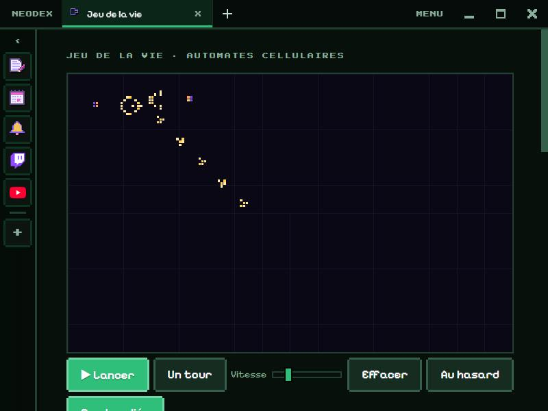

# Game of Life

John Conway's Game of Life (1970): a grid of cells that are born, live and die depending on how many neighbours they have. A few very simple rules, and yet spaceships, oscillators and guns appear.

*Version française : [README.md](README.md)*

## Play

- **Click or drag** on the grid: draw cells. **Right click**: erase.
- **▶ Run / ❚❚ Stop** (or **Space**), **One turn** to step, the **Speed** slider (1 to 60 turns per second).
- **Random** fills the grid, **Clear** empties it.
- **Wrapped edges**: what leaves one side comes back on the other.
- A cell's colour shows its age: pale yellow when just born, then orange, pink, purple and blue for the oldest (still lifes).
- Generation, population and rule are shown, with a population graph.

## Patterns

12 famous patterns, with a thumbnail and their story: glider, lightweight spaceship, blinker, toad, beacon, pulsar, pentadecathlon, Gosper's **glider gun**, R-pentomino, acorn, diehard, block. Pick one and it follows the mouse: **click** to place it (as many times as you like), **R** to rotate it, **Esc** to drop it.

## Rules

A rule is written **B…/S…**: B gives the neighbour counts that give birth to a cell, S those that keep it alive. Conway is B3/S23. Eight ready rules (HighLife, Seeds, Day & Night, Maze, Life without death, Replicator, Morley), or type your own.

## RLE format

The exchange format of every pattern site (like LifeWiki): paste an RLE and **Place** it like a pattern (its rule is used if given), or **Copy the grid as RLE** to share it.

## Data

The grid, rule and speed are kept in the plugin's folder. Permission: `storage` only.
