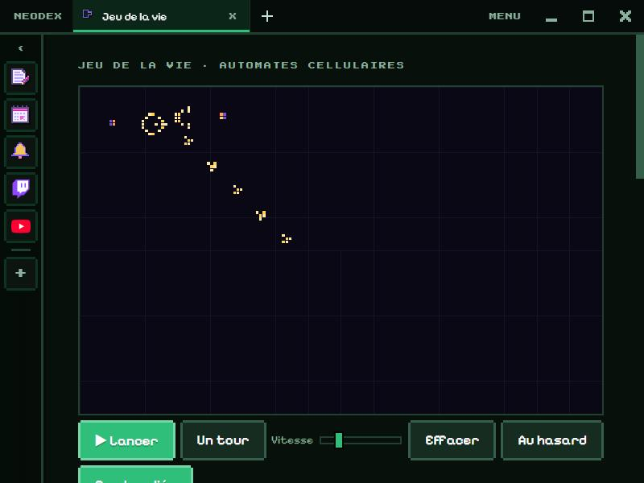

# Jeu de la vie

Le jeu de la vie de John Conway (1970) : une grille de cellules qui naissent, vivent et meurent selon le nombre de leurs voisines. Quelques règles très simples, et pourtant des vaisseaux, des oscillateurs et des canons apparaissent.

*English version: [README.en.md](README.en.md)*

## Jouer

- **Clic ou glisser** sur la grille : dessiner des cellules. **Clic droit** : effacer.
- **▶ Lancer / ❚❚ Arrêter** (ou **Espace**), **Un tour** pour avancer pas à pas, le curseur **Vitesse** (1 à 60 tours par seconde).
- **Au hasard** remplit la grille, **Effacer** la vide.
- **Bords reliés** : ce qui sort d'un côté revient de l'autre.
- La couleur d'une cellule dit son âge : jaune pâle quand elle vient de naître, puis orange, rose, violet et bleu pour les plus vieilles (les natures mortes).
- La génération, la population et la règle sont affichées, avec le graphique de la population.

## Motifs

12 motifs célèbres, avec une miniature et leur histoire : planeur, vaisseau léger, clignotant, crapaud, phare, pulsar, pentadécathlon, **canon à planeurs** de Gosper, R-pentomino, gland, increvable, bloc. Choisis-en un, il suit la souris : **clic** pour le poser (autant de fois que tu veux), **R** pour le tourner, **Échap** pour le lâcher.

## Règles

Une règle s'écrit **B…/S…** : B donne les nombres de voisines qui font naître une cellule, S ceux qui la gardent en vie. Conway, c'est B3/S23. Huit règles prêtes (HighLife, Seeds, Jour et nuit, Labyrinthe, Vie sans mort, Réplicateur, Morley), ou tape la tienne.

## Format RLE

Le format d'échange de tous les sites de motifs (comme LifeWiki) : colle un RLE et **Pose-le** comme un motif (sa règle est reprise si elle est indiquée), ou **Copie la grille en RLE** pour la partager.

## Données

La grille, la règle et la vitesse sont gardées dans le dossier du plugin. Autorisation : `storage` seulement.
